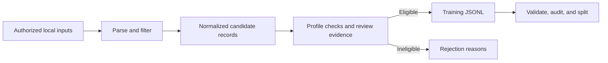

# Nous Agent Safety

**Local collection, review, and export of AI coding trajectories.**

English · [简体中文](README.zh-CN.md)

Nous Agent Safety is a local toolkit for turning supported Claude Code and Codex interactions into inspectable records and training JSONL. It combines project-level collection controls, privacy filtering, review evidence, and dataset validation so that collected activity can be assessed before it becomes training data.

The public implementation focuses on **trajectory data quality and traceability**. It includes the CLI, adapters, review and export pipeline, tests, and synthetic examples under [`colleague/`](colleague/).

> **Developer alpha — `0.1.0a9`.** Collection is off by default. Real-provider, multi-turn acceptance remains incomplete. See [current limitations](#current-limitations) and the [acceptance record](docs/STATUS.md).

## Capabilities

| Area | Implemented behavior |
| --- | --- |
| Local collection | Explicit project opt-in; independent `Stop` hooks for supported Claude Code and Codex transcripts. |
| Historical import | A plan-then-import workflow for local session files, including archived Codex sessions and supported compressed logs. Import does not enable continuous collection. |
| Privacy filtering | Redaction of recognized sensitive values and conservative handling of file-tool content when repository exclusions cannot be verified. |
| Review and export | Profile-specific structural checks, content-bound review evidence, explicit preference labels, and rejection reasons for ineligible samples. |
| Tool trajectories | Supported request snapshots and multi-request function-tool episodes, with separate review of intermediate tool decisions. |
| Dataset validation | File checksums, row counts, source-to-sample links, tool call/result checks, duplicate and conflicting-label checks, and grouped train/evaluation splits. |

A collected record is a **candidate**, not an automatic training label. Missing context, incomplete tool chains, unsupported fields, or insufficient review evidence can prevent export to a training file.

## Data flow



Candidate records retain supported observations, provenance, quality flags, and evidence. Exported training rows contain the selected training fields; `manifest.json` links them back to their source records. Review evidence is bound to content digests, so an earlier acceptance cannot simply be reused after the relevant content changes.

## Quick start

### Requirements

- **Python 3.11–3.14** for the configured test matrix. Core collection, export, and validation use the Python standard library.
- **macOS or Linux** for the local toolkit. Linux CI checks offline behavior; desktop integration acceptance remains separate. Windows is not supported by the current implementation.
- **Git** for cloning and repository file-exclusion checks. If exclusions cannot be verified, affected file-tool content is omitted and marked with a quality gap.
- **Python 3.14** is required for `.jsonl.zst` history import through the standard-library `compression.zstd` module.

The controlled code-task verifier additionally requires macOS `sandbox-exec`. The optional training smoke test has [separate dependencies](colleague/docs/TRAINING_TRAINER.md).

### Run the synthetic example

```bash
git clone https://github.com/LookJohnny/nous-agent-safety.git
cd nous-agent-safety/colleague

nous_demo_root="$(mktemp -d)"
python3 -B hooks/nous_training.py demo --out "$nous_demo_root/dataset"
python3 -B hooks/nous_training.py validate --dataset "$nous_demo_root/dataset"
python3 -B hooks/nous_training.py audit --dataset "$nous_demo_root/dataset" --require-training-rows
```

The demo uses handwritten synthetic fixtures in temporary local state. It does not read real session history, install hooks, enable collection, or call a model provider. The generated data is marked `synthetic: true`; it demonstrates the pipeline, not real task quality or model performance. Output directories must not already exist.

The default demo produces:

| File | Purpose |
| --- | --- |
| `trajectories.jsonl` | Normalized candidate records, including candidates that do not qualify for training. |
| `preferences.jsonl` | Explicit preference records and their evidence. |
| `sft.jsonl` | Samples that pass the selected supervised fine-tuning export checks. |
| `dpo.jsonl` | Eligible, explicitly labeled preference pairs. |
| `rejected.jsonl` | Rejection stages and reason codes, without copying the rejected conversation body. |
| `manifest.json` | Export profile, file statistics and hashes, and per-row source links. |

`validate` checks the exported dataset and returns `valid: true` on success. `audit --require-training-rows` also requires at least one SFT or DPO row. With real inputs, an empty training file can be the correct result when evidence or context is insufficient.

## Work with real sessions

Choose the entry point that matches the data you have:

| Goal | Entry point | Scope |
| --- | --- | --- |
| Collect future session updates | [`setup` and `doctor`](colleague/docs/TRAINING.md#接入-claude-code-和-codex) | `setup` installs hooks and enables the selected project. `doctor` inspects configuration; it does not prove that the platform has executed a hook. |
| Import previous work | [`history-scan` and `history-import`](colleague/docs/TRAINING_HISTORY.md) | Discover local sources, inspect the private plan, then import. The plan can contain local paths and session identifiers. |
| Capture request-level context | [Request observer](colleague/docs/TRAINING_OBSERVER.md) and [episode capture](colleague/docs/TRAINING_EPISODE_CAPTURE.md) | Explicit integration for supported native request/response shapes; ordinary transcript hooks do not provide this context automatically. |
| Review and prepare a dataset | [Review and export guide](colleague/docs/TRAINING.md), [diagnostics](colleague/docs/TRAINING_DIAGNOSE.md), and [grouped splits](colleague/docs/TRAINING_SPLIT.md) | Inspect candidates, supply appropriate evidence, export, validate, and keep related source groups together when splitting. |

Local import, review, and export do not upload data. Project-level collection can be disabled with `disable --project ...`; `--purge` also removes that project's training cache. Previously exported datasets, their copies, and the platforms' original session logs are outside that cache deletion scope.

## Training formats

| Export profile | Training representation | Scope |
| --- | --- | --- |
| `trl` | SFT `messages`; DPO `prompt` / `chosen` / `rejected`; optional `tools` | Supported transcript records; function arguments are JSON objects. DPO requires explicit preference evidence. |
| `openai` | Chat-message representation with JSON-string function arguments | An argument-encoding variant, not a complete OpenAI fine-tuning upload contract. |
| `codemode-events-v1` | String `prompt` / `completion` pairs | Supported visible Codex Code Mode events; SFT only. |
| `request-sft-v1` | String `prompt` / `completion` pairs | Supported observed requests with final-text responses; SFT only. |
| `request-episode-sft-v1` | String `prompt` / `completion` pairs | Supported multi-request function-tool episodes; intermediate targets require step-specific review; SFT only. |

Profile names describe this repository's export contracts. Consumers still need a compatible loader, model template, and loss configuration. For the string prompt/completion profiles, the training smoke tool checks completion-only supervision, including masking tool results in the prompt. See the [format guide](colleague/docs/TRAINING.md) and [training smoke documentation](colleague/docs/TRAINING_TRAINER.md).

## Verification

From the repository root:

```bash
nous_check_root="$(mktemp -d)"
python3 -I -S -B colleague/scripts/training_release_check.py \
  --report "$nous_check_root/release-check.json"
python3 -I -S -B colleague/scripts/training_build.py \
  --out "$nous_check_root/artifacts"
```

The source check runs the included tests and offline synthetic checks. The builder creates allowlisted `.tar.gz` and `.zip` packages, hashes, and a build report, and runs a smoke check on the extracted tar package. Neither command validates real-provider capture or model quality.

[GitHub Actions](https://github.com/LookJohnny/nous-agent-safety/actions/workflows/training.yml) is configured for Ubuntu/macOS × Python 3.11–3.14. Consult the run for the relevant commit for actual results and skips. Packaging details and verification boundaries are documented in the [release guide](colleague/docs/TRAINING_RELEASE.md).

## Current limitations

- **Platform compatibility is bounded.** Transcript formats and supported request shapes are version-sensitive. Missing native context is not reconstructed by guessing. Unknown or unsupported structures can remain candidates or be rejected, depending on the input path.
- **Real-provider acceptance is incomplete.** The documented controlled attempts on 2026-11-16 did not produce strict SFT samples. Historical fixture-backed CLI checks and offline tests do not establish end-to-end compatibility with every Claude Code or Codex release. See [status and next acceptance steps](docs/STATUS.md).
- **Privacy filtering is not an anonymity guarantee.** Recognized secrets and supported personal-information patterns are filtered; names, commercial secrets, and other sensitive content can still require manual review.
- **Validation has a defined scope.** Hashes, source links, and review records support consistency checks. They do not independently establish factual correctness, reviewer identity, content rights, or improved model performance. DPO preferences are not inferred from retries or timestamps.
- **Hidden reasoning and multimodal training are outside the supported scope.** Unsupported reasoning, encrypted context, and media are not converted into complete training examples. Full executable replay and production training orchestration are not provided.

This public distribution does not include the full Lens engine, private research or patent materials, model weights, a hosted data service, or real user datasets. Collection permission is separate from permission to publish, sell, or otherwise reuse the underlying content.

## Repository history and licensing

This repository was previously **SoulForge**, a portable AI identity and companion-runtime project. The earlier implementation is preserved in the [legacy branch](https://github.com/LookJohnny/nous-agent-safety/tree/legacy/soulforge-20261118) and at the [pre-migration commit](https://github.com/LookJohnny/nous-agent-safety/tree/614645cf72277b39196441d91b9fe5e2931f9324). Existing stars reflect the repository's full history. See the [migration record](docs/MIGRATION.md).

The historical SoulForge SDK and specifications retain their original MIT notices. Publication of the current Nous source does not grant a new open-source license. Existing per-file and third-party notices remain applicable.
