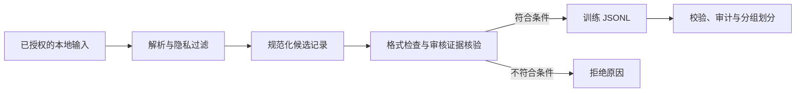

# Nous Agent Safety

**在本地采集、审核 AI 编程轨迹，并导出训练数据。**

[English](README.md) · 简体中文

Nous Agent Safety 是面向 Claude Code 与 Codex 的本地轨迹工具。它将受支持的交互记录整理为可检查的数据，通过项目级采集控制、隐私过滤、审核证据和数据集校验，筛选能够按相应格式导出的训练 JSONL。

当前公开实现聚焦于**轨迹数据质量与可追溯性**。CLI、适配器、审核与导出流程、测试和合成示例位于 [`colleague/`](colleague/)。

> **开发者 Alpha — `0.1.0a9`。** 采集默认关闭，真实模型提供方的完整多轮验收仍未完成。详见[当前限制](#当前限制)和[验收记录](docs/STATUS.md)。

## 已实现的能力

| 方向 | 当前实现 |
| --- | --- |
| 本地采集 | 显式启用指定项目，通过独立 `Stop` hook 读取受支持的 Claude Code、Codex 会话记录。 |
| 历史导入 | 先生成计划，再导入本地会话文件，包含 Codex 归档会话和受支持的压缩日志；不会因此开启持续采集。 |
| 隐私过滤 | 脱敏已识别的敏感值；无法核实仓库文件排除规则时，保守处理相关文件工具内容。 |
| 审核与导出 | 按 profile 检查结构，核验绑定内容的审核证据与显式偏好标签，并记录不合格样本的拒绝原因。 |
| 工具轨迹 | 支持限定范围的请求快照与多请求函数工具 episode，中间工具决策单独审核。 |
| 数据集校验 | 检查文件摘要、行数、训练样本与来源的关联、工具调用和结果、重复及冲突标签；支持按来源分组划分训练集与评估集。 |

采集到的记录首先是**候选数据**。上下文缺失、工具链不完整、字段不受支持或审核证据不足，都可能阻止其进入训练文件。

## 数据流程



候选记录保留受支持的观测内容、来源、质量标记和证据。训练行只包含选定格式的训练字段，`manifest.json` 将它们关联到来源记录。审核证据绑定内容摘要，相关内容发生变化后，不能直接复用先前的通过结果。

## 快速开始

### 环境要求

- 配置的测试矩阵覆盖 **Python 3.11–3.14**。核心采集、导出和校验使用 Python 标准库。
- 本地工具面向 **macOS / Linux**。Linux CI 验证离线行为，桌面客户端集成需单独验收；当前实现不支持 Windows。
- **Git** 用于克隆代码和检查仓库文件排除规则。规则无法核实时，会省略受影响的文件工具内容并标记质量缺口。
- `.jsonl.zst` 历史导入需要 **Python 3.14** 标准库中的 `compression.zstd`。

受控代码任务的独立验收还依赖 macOS `sandbox-exec`。可选的训练 smoke 使用[单独的依赖](colleague/docs/TRAINING_TRAINER.md)。

### 运行合成示例

```bash
git clone https://github.com/LookJohnny/nous-agent-safety.git
cd nous-agent-safety/colleague

nous_demo_root="$(mktemp -d)"
python3 -B hooks/nous_training.py demo --out "$nous_demo_root/dataset"
python3 -B hooks/nous_training.py validate --dataset "$nous_demo_root/dataset"
python3 -B hooks/nous_training.py audit --dataset "$nous_demo_root/dataset" --require-training-rows
```

示例使用手写合成数据和临时本地状态，不读取真实历史、不安装 hook、不开启采集，也不调用模型提供方。生成数据带有 `synthetic: true` 标记，用于演示流程，不代表真实任务质量或模型效果。输出目录必须尚不存在。

默认示例生成以下文件：

| 文件 | 用途 |
| --- | --- |
| `trajectories.jsonl` | 规范化候选记录，可能包含不符合训练条件的数据。 |
| `preferences.jsonl` | 显式偏好记录及其证据。 |
| `sft.jsonl` | 通过所选监督微调导出检查的样本。 |
| `dpo.jsonl` | 符合条件且有显式偏好标签的数据对。 |
| `rejected.jsonl` | 拒绝阶段和原因码，不复制被拒绝的对话正文。 |
| `manifest.json` | 导出 profile、文件统计与摘要、逐行来源关联。 |

`validate` 成功时返回 `valid: true`。`audit --require-training-rows` 还要求至少存在一条 SFT 或 DPO 数据。对于真实输入，如果证据或上下文不足，训练文件为空可以是正确的筛选结果。

## 使用真实会话

根据已有数据选择入口：

| 目标 | 入口 | 范围 |
| --- | --- | --- |
| 采集后续会话更新 | [`setup` 与 `doctor`](colleague/docs/TRAINING.md#接入-claude-code-和-codex) | `setup` 安装 hook 并启用选定项目；`doctor` 检查配置，不证明平台已经执行过 hook。 |
| 导入此前的工作 | [`history-scan` 与 `history-import`](colleague/docs/TRAINING_HISTORY.md) | 发现本地来源、检查私有计划，再执行导入；计划可能包含本机路径和会话标识。 |
| 采集请求级上下文 | [请求观察器](colleague/docs/TRAINING_OBSERVER.md)与 [episode 采集](colleague/docs/TRAINING_EPISODE_CAPTURE.md) | 显式接入受支持的原生请求／响应结构；普通会话 hook 不会自动提供这些上下文。 |
| 审核并准备数据集 | [审核与导出指南](colleague/docs/TRAINING.md)、[诊断](colleague/docs/TRAINING_DIAGNOSE.md)、[分组划分](colleague/docs/TRAINING_SPLIT.md) | 检查候选、提供相应证据、导出并校验；划分时将相关来源保留在同一组。 |

本地导入、审核和导出不上传数据。`disable --project ...` 可停用指定项目；添加 `--purge` 还会删除该项目的训练缓存。已导出的数据集及副本、平台原始会话日志不在缓存删除范围内。

## 训练格式

| 导出 profile | 训练表示 | 范围 |
| --- | --- | --- |
| `trl` | SFT 使用 `messages`；DPO 使用 `prompt` / `chosen` / `rejected`；可带 `tools` | 受支持的会话记录，函数参数为 JSON 对象；DPO 必须有显式偏好证据。 |
| `openai` | 函数参数为 JSON 字符串的聊天消息表示 | 表示参数编码方式，不是完整的 OpenAI 微调上传协议。 |
| `codemode-events-v1` | 字符串 `prompt` / `completion` | 受支持的 Codex Code Mode 可见事件；仅 SFT。 |
| `request-sft-v1` | 字符串 `prompt` / `completion` | 受支持的实际请求及最终文本响应；仅 SFT。 |
| `request-episode-sft-v1` | 字符串 `prompt` / `completion` | 受支持的多请求函数工具 episode；中间目标须有对应步骤审核；仅 SFT。 |

这些名称描述本仓库的导出契约。使用方仍需配置兼容的数据加载器、模型模板和损失计算。对于字符串 prompt/completion 格式，训练 smoke 会检查仅对 completion 计算损失，包括屏蔽 prompt 中的工具结果。详见[格式指南](colleague/docs/TRAINING.md)和[训练 smoke 文档](colleague/docs/TRAINING_TRAINER.md)。

## 验证与构建

在仓库根目录运行：

```bash
nous_check_root="$(mktemp -d)"
python3 -I -S -B colleague/scripts/training_release_check.py \
  --report "$nous_check_root/release-check.json"
python3 -I -S -B colleague/scripts/training_build.py \
  --out "$nous_check_root/artifacts"
```

源码检查运行仓库内测试与离线合成检查。构建器生成白名单范围的 `.tar.gz`、`.zip`、摘要和构建报告，并对解压后的 tar 包运行 smoke。两个命令均不验证真实提供方采集或模型效果。

[GitHub Actions](https://github.com/LookJohnny/nous-agent-safety/actions/workflows/training.yml) 配置了 Ubuntu/macOS × Python 3.11–3.14 矩阵，实际结果和跳过项以对应提交的运行记录为准。打包方式和验证边界见[发布指南](colleague/docs/TRAINING_RELEASE.md)。

## 当前限制

- **平台兼容有边界。** 会话格式和受支持的请求结构受版本影响，不会通过猜测补全缺失的原生上下文；未知或不受支持的结构会按输入路径保留为候选或被拒绝。
- **真实提供方验收尚未完成。** 2026-11-16 记录的受控尝试未产生严格 SFT 样本。历史脚本提供商 CLI 检查与离线测试不能证明所有 Claude Code、Codex 版本的端到端兼容性。详见[状态与后续验收](docs/STATUS.md)。
- **隐私过滤不保证完全匿名。** 已识别的密钥和受支持的个人信息模式会被过滤，姓名、商业秘密及其他敏感内容仍可能需要人工复核。
- **校验具有明确范围。** 摘要、来源关联和审核记录支持一致性检查，不独立证明事实正确、审核者身份、内容权利或模型收益。DPO 偏好不会从重试或时间顺序推断。
- **不覆盖隐藏推理与多模态训练。** 不受支持的推理、加密上下文及媒体不会被转换成完整训练样本；当前也不提供完整可执行重放或生产训练调度。

公开发行内容不包含完整 Lens 引擎、私有研究与专利材料、模型权重、托管数据服务或真实用户数据集。允许采集不等于允许公开、销售或以其他方式复用底层内容。

## 仓库历史与许可

本仓库原名 **SoulForge**，此前开发可移植 AI 身份与伴侣运行时。旧实现保存在[历史分支](https://github.com/LookJohnny/nous-agent-safety/tree/legacy/soulforge-20261118)与[迁移前提交](https://github.com/LookJohnny/nous-agent-safety/tree/614645cf72277b39196441d91b9fe5e2931f9324)。已有 stars 反映仓库整个发展历史，详见[迁移记录](docs/MIGRATION.md)。

历史 SoulForge SDK 与规范保留原有 MIT 声明。当前 Nous 源码公开并不新增开源许可证授权；已有逐文件和第三方许可声明继续适用。
